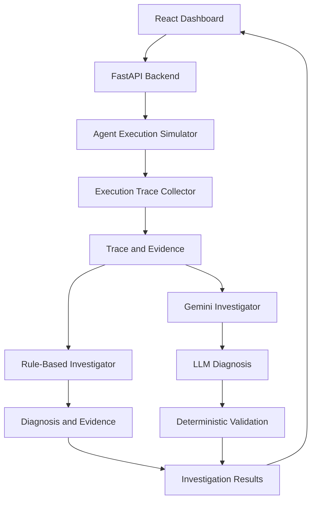

# AgentOps Investigator

**Debugging and root-cause analysis for AI agent executions.**

AgentOps Investigator is a full-stack application that simulates AI agent executions, captures execution traces, identifies failures, and compares deterministic investigation with a Gemini-powered investigator.

It is designed to make agent failures easier to understand by connecting tool calls, execution evidence, failure classifications, and investigation results in one dashboard.


---

## Overview

AI agents can fail in ways that are difficult to diagnose: tools time out, responses are malformed, calls repeat unnecessarily, and generated answers may contradict the available evidence.

AgentOps Investigator explores how execution tracing and automated investigation can help diagnose these problems.

The application provides a controlled environment for triggering failure scenarios, inspecting execution traces, and comparing a rule-based investigator with a Gemini-powered investigation system.

## Key features

- **Execution tracing** — inspect recorded events from simulated agent runs.
- **Scenario-based testing** — reproduce success cases and different execution failures.
- **Deterministic investigation** — classify failures using predefined rules and available evidence.
- **Gemini-powered investigation** — use an LLM to analyze execution traces and propose diagnoses.
- **Investigator comparison** — evaluate investigation outcomes against a benchmark of scenarios.
- **Evidence validation** — combine model-generated diagnoses with deterministic validation.
- **Replay support** — replay a run through the available API endpoint.

## How it works



The deterministic and LLM-based approaches can be compared using the same simulated execution scenarios. The validation layer helps assess whether an LLM-generated investigation is supported by the available evidence.

## Failure scenarios

The dashboard supports scenarios such as:

| Scenario | What it tests |
|---|---|
| Success | Normal agent execution |
| Missing order ID | Missing required input |
| Tool timeout | Tool execution failure |
| Repeated tool call | Unnecessary repeated execution |
| Malformed tool response | Invalid tool output |
| Unsupported answer | Answer not adequately supported by evidence |
| Conflicting evidence | Inconsistent information |
| Multiple failures | More than one failure in a run |
| Misleading answer | Potentially misleading agent output |

## Technology stack

| Layer | Technologies |
|---|---|
| Frontend | React, Vite, JavaScript, CSS |
| Backend | Python, FastAPI, Pydantic |
| LLM integration | Google Gemini via `google-genai` |
| Testing | Pytest, HTTPX |
| Evaluation | Custom benchmark and investigator comparison scripts |

## Getting started

### Prerequisites

- Python 3.11 or a compatible version for the project's dependencies
- Node.js and npm
- A Google Gemini API key for LLM-powered investigation

### 1. Clone the repository

```bash
git clone https://github.com/YOUR_USERNAME/agentops-investigator.git
cd agentops-investigator
```

Replace `YOUR_USERNAME` with your GitHub username.

### 2. Set up the backend

Create and activate a virtual environment.

**Windows PowerShell**

```powershell
python -m venv .venv
.\.venv\Scripts\Activate.ps1
```

Install the dependencies:

```powershell
python -m pip install -r requirements.txt
```

### 3. Configure Gemini

Set your API key in a local `.env` file in the project root, using the environment variable name expected by the application:

```env
GEMINI_API_KEY=your_api_key_here
```

Never commit `.env` or expose your API key. The key is only required for features that use Gemini; availability of other endpoints depends on their implementation.

### 4. Start the backend

From the project root:

```powershell
python -m uvicorn app.main:app --reload
```

The API should be available at:

- API: `http://127.0.0.1:8000`
- Interactive API documentation: `http://127.0.0.1:8000/docs`

### 5. Start the frontend

Open a second terminal:

```powershell
cd frontend
npm install
npm run dev
```

Open the local URL printed by Vite, typically `http://localhost:5173`.

## API endpoints

| Method | Endpoint | Purpose |
|---|---|---|
| `GET` | `/health` | Health check |
| `POST` | `/runs/demo` | Create a simulated agent run |
| `GET` | `/runs/{run_id}` | Retrieve run details |
| `GET` | `/runs/{run_id}/investigation` | Retrieve rule-based investigation |
| `GET` | `/runs/{run_id}/llm-investigation` | Retrieve LLM-based investigation |
| `POST` | `/runs/{run_id}/replay` | Replay a run with an order ID |

Refer to `/docs` for the request schemas and response formats.

## Testing and evaluation

### Automated tests

The project has **34 passing tests** in the latest recorded test run.

Run the test suite with:

```bash
python -m pytest -q
```

### Investigator benchmark

The latest recorded benchmark evaluated 11 scenarios.

| Metric | Rule-based | Gemini + validation |
|---|---:|---:|
| Scenario accuracy | 100% | 100% |
| Evidence validity | 100% | 100% |
| Successful investigation calls | — | 11 / 11 |
| Average investigation latency | 0.02 ms | 1.56 s |

**Interpretation:** These results apply to the project's 11-scenario benchmark, not to arbitrary production workloads. The Gemini result measures the combined LLM and deterministic-validation system, not the standalone model. Latency is environment-dependent.

Run the benchmark comparison with:

```bash
python -m benchmark.compare_investigators
```

The comparison script generates a report at `benchmark/compare_report.json` when executed. Generated reports are excluded from Git by the project's ignore rules.

## Project structure

```text
agentops-investigator/
├── app/
│   ├── agents/
│   │   ├── execution_agent.py
│   │   ├── investigator.py
│   │   ├── llm_investigator.py
│   │   └── replay.py
│   ├── tools/
│   ├── tracing/
│   └── main.py
├── benchmark/
│   ├── compare_investigators.py
│   └── run_benchmark.py
├── frontend/
│   └── src/
├── tests/
├── requirements.txt
├── .gitignore
└── README.md
```

## Current scope and limitations

- Agent execution and failures are simulated; this is not yet a production observability platform.
- Benchmark results are based on a small, predefined set of scenarios.
- Gemini-based investigation depends on API availability, credentials, and model behavior.
- Results should not be interpreted as a guarantee of correctness on unseen agent traces.

## Future improvements

- Integrate traces from real agent frameworks.
- Add persistent run history and searchable investigations.
- Expand the benchmark with unseen scenarios and more rigorous evaluation.
- Measure diagnosis precision, recall, latency, and cost across larger test sets.
- Add trace export and richer evidence visualization.

---

**Built to explore reliable debugging and evidence-grounded investigation for AI agents.**